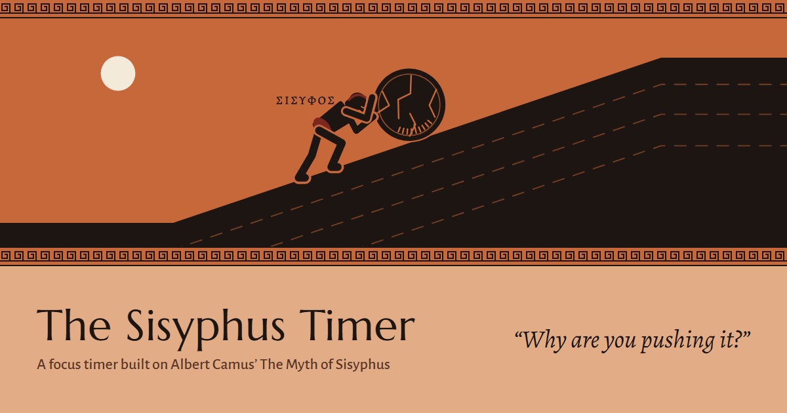

# The Sisyphus Timer

A focus timer built on Albert Camus' *The Myth of Sisyphus*, made for a philosophy course.

**Live:** https://the-sisyphus-timer.vercel.app  ·  **Română:** https://the-sisyphus-timer.vercel.app/ro/



## The idea

Student life works like the punishment of Sisyphus. You finish one exam and the next one is already waiting. Camus asks what to do once you notice that. You can look away (escape), bet that it all pays off later (hope, which he calls the leap), or keep pushing with your eyes open (revolt). Camus chooses revolt: *"One must imagine Sisyphus happy."*

The timer turns that argument into something you can try instead of only read about.

| In the timer | In Camus |
|---|---|
| A focus session | Pushing the rock up the mountain |
| The session ends | The rock rolls back down. There is always another exam. |
| The break | The walk down, "the hour of consciousness" |
| Pop-up distractions | The gods, whom Sisyphus scorns |
| "Why are you pushing it?" after every session | The absurd question, asked on purpose |
| Escape, hope or revolt | Camus' three answers |
| The mood meter | Whether we can imagine Sisyphus happy |

## Pages

| Page | What it does |
|---|---|
| Timer | The vase-painting scene, the timer, settings and your stats |
| Heroes | Camus' five absurd heroes (Sisyphus, Don Juan, the Actor, the Conqueror, the Creator), unlocked by boulders pushed |
| Inscriptions | Every answer you gave, with copy and download |
| Trophies | 15 trophies, an 8-week calendar and a shareable image card |
| The idea | The myth, the argument, and sources |
| Worldviews | Camus next to Nietzsche, Kierkegaard, Marcus Aurelius, Epicurus, Confucius and Zen, plus a worldview test: seven situations from student life, and which of the seven you sound like |
| Class | Class mode: the presenter shows a QR code, everyone answers from their phone, results appear live. The room can also take the worldview test together |
| Present | A ready-made slide deck with the live timer and the class vote built in, plus speaker notes |

## How it is built

- Static HTML, CSS and plain JavaScript modules. No framework, no build step.
- `api/room.js` is one Vercel Function for class mode. It stores rooms in Upstash Redis through its REST API, with no npm dependencies. Rooms expire after 12 hours and no names are collected.
- Personal data (stats, answers, settings) stays in the browser's `localStorage`.
- Installable as an app and usable offline (`manifest.webmanifest`, `sw.js`).
- English pages live at the root and Romanian pages under `/ro/`. Interface strings are in `js/i18n.js`, content in `js/data-en.js` and `js/data-ro.js`.

## Run it locally

Everything except class mode works from any static server, for example:

```
npx serve .
```

Class mode needs the Vercel CLI and the project's environment variables:

```
vercel dev
```

## Deploy

Pushing to `main` deploys to Vercel. Class mode needs `KV_REST_API_URL` and `KV_REST_API_TOKEN`, provided by an Upstash Redis store from the Vercel Marketplace.

## Sources

- Albert Camus, *The Myth of Sisyphus* (*Le Mythe de Sisyphe*, 1942), translated by Justin O'Brien (Knopf, 1955). Every English Camus quotation.
- Friedrich Nietzsche, *Ecce Homo* (1888), translated by Walter Kaufmann (1967).
- Søren Kierkegaard, *Concluding Unscientific Postscript* (1846), translated by David F. Swenson and Walter Lowrie (1941).
- Marcus Aurelius, *Meditations*, translated by Gregory Hays (2002).
- Epicurus, "Live unnoticed", known through Plutarch's *Moralia*.
- Confucius, *The Analects*, translated by James Legge (1861).
- Homer, *The Odyssey*, book 11.

The Romanian quotations were translated for this project from the original texts.
